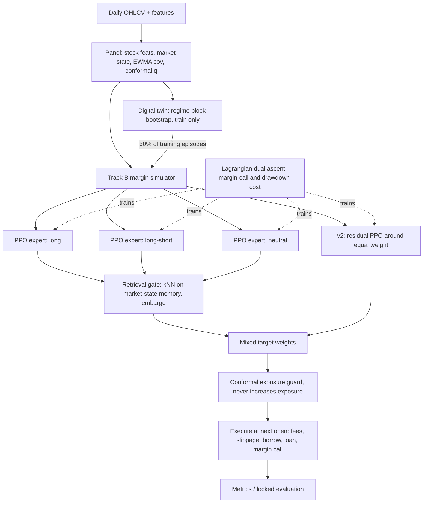

# MARS-RL architecture

## Decision timeline (no look-ahead)
Decision at close of day t → order executed at open of t+1 → marked to market at close of t+1.

## Simulator (Track B, `src/margin_env.py`)
Single margin account with signed shares. equity = cash + Σ shares·price; margin level = equity / gross. Costs on every strategy: 0.1% fee + 2 bp slippage per side, 0.5%/yr borrow fee on short value, 4%/yr loan on borrowed cash. Margin level < 40% blocks risk-increasing trades; < 30% forces liquidation to 50% + 0.1% fee. Initial equity 100,000; ruin at 20%. Simplified vs the authors' separate long/short ledgers (Track A runs their original env).

## Action → weights (`weights_from_action`)
Action ∈ [−1,1]^(N+1). Last entry = leverage L = Lmax·(a+1)/2 (or fixed). Modes: `long` (positive part normalised), `ls` (signed, gross = L), `neutral` (demeaned), `split` (50/50 long/short), **`resid`** (w = softmax(κ·a_w)·L, a_w = 0 → equal weight).

## Reward
`plain`: 100·log-return. `mt` (paper-style): + 5-step Sharpe. `mars`: 100·log-return − μ_m·1[margin call] − μ_d·100·max(0, DD − 10%) − η·(100·min(r,0))², μ updated by dual ascent after every rollout (clip [0,5]; budgets 0.001 margin calls/step, 0.01 DD-excess/step). v2 adds a turnover penalty and execution smoothing w = s·target + (1−s)·previous (s = 0.3).

## Conformal guard (`MarginTradingEnv.apply_guard`)
score_t = |r_EW,t| / σ_EW,t−1 (EWMA λ = 0.94); q_t = rolling 95% quantile over 250 days; scale = min(1, B / (q_t·√(wᵀΣ_t w))). B = 0.03 for v2_b (0.02 / 0.015 / 0.05 / 0.08 tried, see log).

## Digital twin (`src/twin.py`)
Train-only. 3 volatility regimes (terciles of past 20-day market vol), Markov regime chain, geometric blocks (mean 10) of whole cross-sections, OHLC rebuilt from resampled ratios and passed through the same feature code. Fidelity vs real train: vol 0.218 vs 0.225, excess kurtosis 5.9 vs 6.2, avg corr 0.41. Crash stress: demeaned log-returns ×1.3, −0.15%/day drift.

## Retrieval gate (`src/gating.py`)
Embedding = 9 market-state features (standardised on train). Memory item for day s: each expert's 20-day forward Sharpe. For decision day t only s ≤ t−20 is retrievable (embargo, unit-tested). k = 30, softmax β = 10, shrink 0.5 to uniform. Result so far: gate ≈ shuffled-memory gate → no evidence retrieval helps.

## Not implemented / never evaluated
LLM news agent (schemas + staleness decay, code only), Mamba/SSM encoder, DAgger distillation student, causal module, factorial 2×2×2, twin-ratio sweep beyond 0/50%.
